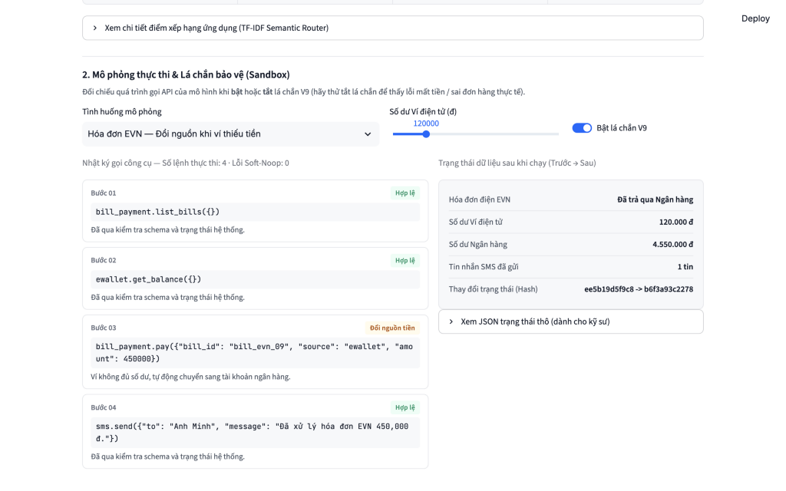
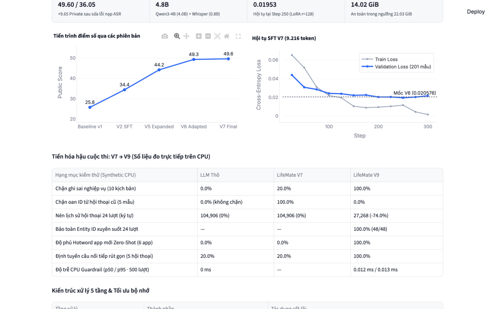
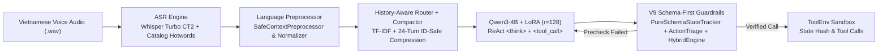

# LifeMate — Vietnamese Voice-to-Action Agent (< 6B Offline SLM)


-orange)

-0068FF)


End-to-end offline Vietnamese **Voice-to-Action AI Agent** built for the **Zalo AI Challenge 2026 (LifeMate Track)** and engineered post-competition into **V9 Schema-First** for zero-shot app scaling, 24-turn context compaction, and deterministic transaction safety.

> **Architecture Deep-Dive:** Read the 1-page systems engineering breakdown in [`docs/ARCHITECTURE_CASE_STUDY.md`](docs/ARCHITECTURE_CASE_STUDY.md).

---

## Interactive Demo & Product Showcase

Designed with a distraction-free **Zalo Daylight** interface executing genuine `src/` Python modules offline on CPU. Launch locally (`streamlit run app.py`) or deploy the lightweight `deploy-streamlit` branch directly on [share.streamlit.io](https://share.streamlit.io):

| 1. Instant Vietnamese Assistant (`Thử nghiệm Trợ lý`) | 2. ReAct Trace & State Sandbox (`Bảo vệ Giao dịch`) |
|---|---|
|  |  |

| 3. FinTech & V9 Schema-First Matrix (`An toàn Giao dịch`) | 4. Architecture, L4 Profile & V7 → V9 Benchmark (`Hiệu năng`) |
|---|---|
|  |  |

> **Data & IP Compliance Note:** Per the Zalo AI Challenge 2026 regulations, all competition datasets (`train/`, `public_test/`, `private_test/`, audio `.wav` files, and competition submissions) are strictly excluded from this repository. Clean synthetic scenarios power [`examples/offline_agent_demo.py`](examples/offline_agent_demo.py), [`scripts/benchmarks/benchmark_v9_suite.py`](scripts/benchmarks/benchmark_v9_suite.py), and [`tests/`](tests/).

---

## Competition Results & Silent-Bug Post-Mortem

- **Model Size Budget:** `< 6B` total parameters (`< 5B` LLM): `Qwen/Qwen3-4B` (~4.0B) + `faster-whisper-large-v3-turbo-ct2` (~0.8B) = **~4.8B parameters**
- **Context & Runtime SLA:** `<= 16,384` context tokens · `<= 30s / sample` · **100% deterministic offline execution** (`temperature = 0`, `--network none` Docker container)
- **Public Leaderboard Progression (Team Highest):**
  `25.80` → `34.40` → `44.20` → **`49.30` (V6)** → **`49.60` (V7 Final)**
- **Private Evaluation & Root-Cause Recovery (`26.40` → `36.05`, `+9.65` points):**
  - Auditing the initial `26.40` blind evaluation uncovered a silent pipeline misconfiguration: ASR inference fell back to base `faster-whisper-large-v3-turbo-ct2` weights instead of the fine-tuned Vietnamese checkpoint, compounded by shared cache/resume collisions.
  - Isolating fresh ASR caches, re-running with the fine-tuned Vietnamese Whisper checkpoint, and verifying deterministic `state_hash` replay across all outputs lifted the Private Score by **`+9.65` points to `36.05`**.
  - General engineering bottlenecks surfaced during multi-turn evaluation—long-horizon context bloat, multi-turn ASR compounding, and unseen tool schemas—directly drove the **V9 Schema-First** redesign below.

---

## V9 Reproducible CPU Benchmark (100% Synthetic Suite)

Run `python3 scripts/benchmarks/benchmark_v9_suite.py` locally (zero GPU or external API required):

| Metric | Raw LLM | V7 Legacy Rules | V9 Schema-First |
|---|---:|---:|---:|
| Unsafe Write Interception (10 adversarial cases) | 0.0% | 20.0% | **100.0%** |
| History Entity False-Positive Block Rate (5 follow-ups) | 0.0% (no guard) | 100.0% | **0.0%** |
| 24-Turn History Prompt Savings (chars) | 0.0% (104,906) | 0.0% (104,906) | **-74.0% (27,268)** |
| 24-Turn Entity ID Retention | — | — | **100.0%** (48/48) |
| Zero-Shot Unseen App Hotword Coverage (6 apps) | 0.0% | 0.0% | **100.0%** |
| Elliptic Follow-Up Top-1 Routing (5 dialogues) | 20.0% | 20.0% | **100.0%** |
| Guardrail Pre-Execution CPU Latency (p50 / p95 over 500 calls) | 0 ms | — | **0.012 ms / 0.013 ms** |

---

## System Architecture



### Core Engineering Highlights

1. **Zero-Truncation Long-Context Fine-Tuning on 24GB NVIDIA L4** ([`notebooks/Train_Qwen3_4B_ZAIC2026_V7_L4_Max.ipynb`](notebooks/Train_Qwen3_4B_ZAIC2026_V7_L4_Max.ipynb), [`train_sft.py`](train_sft.py)):
   - Full multi-turn tool trajectories span up to **8.5k–8.8k tokens** (`MAX_SEQ_LEN = 9216`), overflowing naive 4k/8k caps and truncating final `<tool_call>` turns.
   - Implemented **`ChunkedLossTrainer`** computing `lm_head` + cross-entropy in 256-token active assistant chunks, slashing CE logits memory from **5.30 GiB → 0.15 GiB** (`14.02 / 22.03 GiB` peak L4 VRAM) with native `bf16` + `LoRA r=128, alpha=256`, converging to `val_loss = 0.019530` at `checkpoint-250`.

2. **V9 Schema-First Execution Guardrails** ([`src/guardrail.py`](src/guardrail.py), [`src/action_triage.py`](src/action_triage.py)):
   - **Singular/Plural & FK Isolation:** Reconciles singular tool outputs (`booking`, `appointment`, `item`) with plural `x-ref` declarations (`bookings`, `appointments`, `items`) inside the same app (**0% false-positive history blocks**), isolates foreign keys from primary entity IDs, and keeps cross-app collections strictly locked.
   - **Generic Constraint & Dependency Gates:** Enforces `x-one-of` groups, temporal ordering (`check_in < check_out`, `start_date <= end_date`), ISO-8601 `+07:00` offsets, `max_guests` capacity, `available` flags, `room_type`, `slots` / operating hours, `episode` bounds, `get_menu` before `place_order`, and return eligibility.

3. **Zero-Shot App Scaling & 24-Turn Compaction** ([`src/asr.py`](src/asr.py), [`src/router.py`](src/router.py), [`src/prompt_builder.py`](src/prompt_builder.py)):
   - **Catalog-Driven ASR Hotwords:** Automatically harvests `name_vi`, description clauses, and readable `enum` values for newly added apps alongside history entity names.
   - **History-Aware Semantic Routing:** Blends `(1,2)`-gram TF-IDF with a calibrated recent-app boost (`+0.12` / `+0.06`) to resolve elliptic follow-ups without disrupting explicit topic switches.
   - **24-Turn History Compactor:** Preserves the latest dialogue turns verbatim while stripping verbose prose from older `tool_results` (**-74.0% characters**, **100% Entity ID retention**).

4. **Deterministic Financial Safety & Reproducible Docker** ([`src/hybrid_engine.py`](src/hybrid_engine.py), [`src/number_parser.py`](src/number_parser.py), [`src/agent.py`](src/agent.py), [`Dockerfile`](Dockerfile)):
   - Validates `ewallet` vs `bank` balances before `bill_payment.pay`, suppresses false confirmation SMS when fallback fails, parses compound Vietnamese monetary amounts, and runs cleanly inside `--network none` CUDA containers.

---

## Repository Structure

```text
├── app.py                      # Minimalist Zalo-inspired Streamlit product UI (3 focused views)
├── demo/                       # Sandbox scenarios, 7-case chaos matrix & V9 analytics backend
├── assets/screenshots/         # Verified Zalo Daylight captures for portfolio & case study
├── .streamlit/config.toml      # Clean daylight Zalo theme (#FFFFFF / #F7F8FA / #0068FF)
├── src/                        # Core runtime: V9 guardrails, ASR hotwords, compactor, router, agent
├── notebooks/                  # L4 Max Chunked-CE training (V6/V7) & resumable Colab inference
├── examples/                   # Standalone zero-dependency offline guardrail showcase demo
├── tests/                      # 52 unit & regression tests (including 12 V9 schema/compaction tests)
├── scripts/
│   ├── data/                   # SFT dataset builders & simulator trajectory validators
│   ├── benchmarks/             # V9 CPU suite (benchmark_v9_suite.py), ASR & training benchmarks
│   └── prepare_saved_models.py # LoRA merge & offline model packaging utilities
├── configs/                    # Training & GRPO/RLVR hyperparameter configurations
├── docs/                       # Architecture case study & post-competition engineering roadmap
├── Dockerfile & predict.py     # Offline Docker submission skeleton (predict.sh & start_jupyter.sh)
├── train_sft.py                # Standalone SFT training CLI with ChunkedLossTrainer
└── train_grpo_rlvr.py          # Verifiable-reward GRPO reinforcement fine-tuning pipeline
```

---

## Quickstart (Zero-Dependency Local Verification)

Core V9 guardrail, compaction, routing, benchmark, showcase, and Docker contract checks run with Python standard library alone (`scikit-learn` / `torch` / `vllm` are optional for GPU training or full model inference):

```bash
# 1. Run full unit & regression suite (52 tests)
python3 -m unittest discover -s tests -v

# 2. Run the reproducible V9 CPU benchmark
python3 scripts/benchmarks/benchmark_v9_suite.py

# 3. Launch the minimalist Zalo Daylight product UI
pip install -r requirements-streamlit.txt
streamlit run app.py

# 4. Run the synthetic CLI showcase
python3 examples/offline_agent_demo.py
```

> **1-Click Streamlit Cloud Deploy:** Select branch **`deploy-streamlit`** and entrypoint **`app.py`** on [share.streamlit.io](https://share.streamlit.io) — that branch swaps in lightweight dependencies (`requirements-streamlit.txt`) while keeping `main` 100% aligned with the offline GPU Docker spec.

For full GPU training (`pip install -r requirements.txt`) and offline Docker packaging instructions, see [`HANDOFF_DOCKER.md`](HANDOFF_DOCKER.md) and [`training_code/README.md`](training_code/README.md).

---

## Attribution

- **Origin & Team Contribution:** Built on top of our team's Zalo AI Challenge 2026 LifeMate repository (`sun0810pi/zalo-challenge`).
- **Personal Contributions (Hà Sỹ Phong):** Designed the L4 Max `ChunkedLossTrainer` 9,216-token SFT training workflows (`V6: 49.30` → `V7: 49.60`, team-highest public submissions), audited private-test inference to resolve the silent Whisper checkpoint & cache collision bug (`26.40` → `36.05`, `+9.65` points), engineered the post-competition **V9 Schema-First** safety, zero-shot hotword, history-aware routing, and 24-turn compaction architecture, authored the reproducible CPU benchmark suite & architecture case study, and built this standalone Streamlit product demo.
