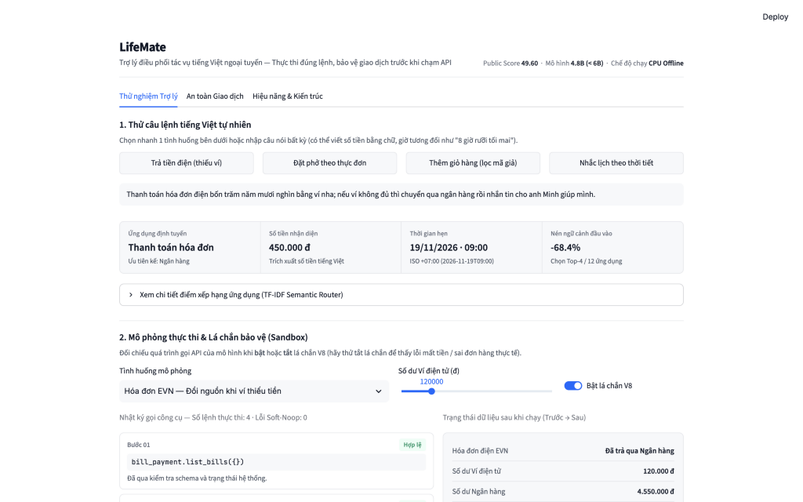
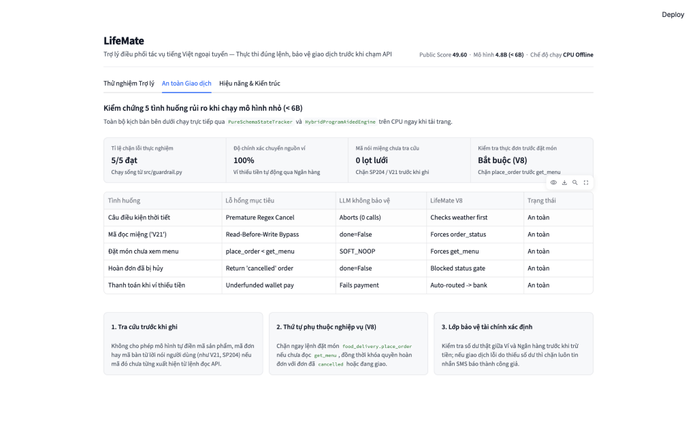
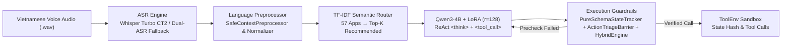

# LifeMate — Vietnamese Voice-to-Action Agent (< 6B Offline SLM)


-orange)


End-to-end offline Vietnamese **Voice-to-Action AI Agent** built for the **Zalo AI Challenge 2026 (LifeMate Track)** and refined around product minimalism, speed, and deterministic transaction safety (**V8 Guardrails**).

---

## Interactive Demo & Product Showcase

Designed with a distraction-free **Zalo Daylight** interface running genuine `src/` Python modules offline on CPU. Launch locally (`streamlit run app.py`) or deploy the lightweight `deploy-streamlit` branch directly on Streamlit Community Cloud (`app.py`):

| 1. Instant Vietnamese Assistant (`Thử nghiệm Trợ lý`) | 2. ReAct Trace & State Sandbox (`Bảo vệ Giao dịch`) |
|---|---|
|  |  |

| 3. FinTech & V8 Safety Verification (`An toàn Giao dịch`) | 4. Architecture & L4 Memory Profile (`Hiệu năng & Kiến trúc`) |
|---|---|
|  |  |

> **Data & IP Compliance Note:** Per the Zalo AI Challenge 2026 regulations, all competition datasets (`train/`, `public_test/`, `private_test/`, audio `.wav` files, and SFT JSONL splits) are strictly excluded from this repository. Clean synthetic scenarios are provided in [`examples/offline_agent_demo.py`](examples/offline_agent_demo.py) and [`tests/`](tests/) so core architecture, guardrails, and Docker conformance checks run cleanly out of the box.

---

## Key Competition Constraints & Results

- **Model Size Budget:** `< 6B` total system parameters (`< 5B` LLM): `Qwen/Qwen3-4B` (~4.0B) + `faster-whisper-large-v3-turbo-ct2` (~0.8B) = **~4.8B parameters**
- **Context & Runtime SLA:** `<= 16,384` context tokens · `<= 30s / sample` · **100% deterministic offline execution** (`temperature = 0`, `--network none` Docker container)
- **Public Leaderboard Score Progression (Team Highest):**
  `25.80` → `34.40` → `44.20` → **`49.30` (V6)** → **`49.60` (V7 Final Submission)**

---

## System Architecture



### Core Engineering Highlights

1. **Zero-Truncation Long-Context Fine-Tuning on 24GB NVIDIA L4** ([`notebooks/Train_Qwen3_4B_ZAIC2026_V7_L4_Max.ipynb`](notebooks/Train_Qwen3_4B_ZAIC2026_V7_L4_Max.ipynb)):
   - Full multi-turn tool trajectories span up to **8.5k–8.8k tokens** (`MAX_SEQ_LEN = 9216`), overflowing naive 4k/8k caps and truncating final `<tool_call>` turns.
   - Implemented **`ChunkedLossTrainer`** computing `lm_head` + cross-entropy in 256-token active assistant chunks, eliminating 3.5+ GiB logits OOMs on L4 while keeping native `bf16` weights + `LoRA r=128, alpha=256` (`paged_adamw_8bit`, `lr=1.5e-4`, `eval_steps=25`, `EarlyStoppingCallback`).
   - V7 converged cleanly to `val_loss = 0.019530` at `checkpoint-250`, improving over V6's `0.020576`.

2. **Schema-Driven Read-Before-Write & V8 Dependency Guardrails** ([`src/guardrail.py`](src/guardrail.py), [`src/action_triage.py`](src/action_triage.py)):
   - `PureSchemaStateTracker` dynamically enforces catalog `x-ref` membership, prevents cross-collection entity leakage (e.g., `pantry` IDs passed into `grocery` carts), blocks ungrounded spoken alphanumeric tokens (e.g., `V21`, `SE7`, `B05`) until resolved via read tools, and validates device types/stock/seat availability before touching `ToolEnv.call()`.
   - **V8 Dependency & Eligibility Gates:** Blocks premature order writes (e.g., `food_delivery.place_order` before `food_delivery.get_menu`) and blocks return/refund calls against ineligible order statuses (`cancelled`, `shipping`, `pending`).
   - `ActionTriageBarrier` intercepts premature `sys.ask_missing_info` calls when required IDs can still be queried via installed read tools or context profiles.

3. **Deterministic Financial, Temporal & Conditional Safety Layer** ([`src/hybrid_engine.py`](src/hybrid_engine.py), [`src/number_parser.py`](src/number_parser.py), [`src/datetime_engine.py`](src/datetime_engine.py)):
   - `HybridProgramAidedEngine` protects high-stakes write operations: validates `ewallet` vs `bank` balances before `bill_payment.pay` (suppressing false confirmation SMS when fallback conditions fail), checks multi-day weather conditions before firing conditional reminders, parses compound Vietnamese numerals (`"hai triệu năm trăm nghìn"` → `2500000`), and enforces ISO-8601 `+07:00` timestamps.

4. **Reproducible Offline Docker & Unified Serial/Batched ReAct Loop** ([`src/agent.py`](src/agent.py), [`predict.py`](predict.py), [`Dockerfile`](Dockerfile)):
   - Unified `ReActSessionState` + `step_react_state` across single-sample inference, vLLM continuous batching (`run_infer_batched.py`), and the official offline Docker container (`nvidia/cuda:13.2.0-devel-ubuntu22.04`, `--network none`).
   - Checkpoint-resumable Colab inference ([`notebooks/V7_Infer_Colab.ipynb`](notebooks/V7_Infer_Colab.ipynb)) with audit tracing, replay-hash verification, and determinism checks.

---

## Repository Structure

```text
├── app.py                      # Minimalist Zalo-inspired Streamlit product UI (3 focused views)
├── demo/                       # Sandbox scenarios, chaos-test matrix & benchmark analytics
├── assets/screenshots/         # Clean UI showcase captures for LinkedIn & documentation
├── .streamlit/config.toml      # Clean daylight Zalo theme (#FFFFFF / #F7F8FA / #0068FF)
├── src/                        # Core runtime: agent loop, ASR, guardrails, hybrid engine, router
├── notebooks/                  # L4 Max Chunked-CE training (V6/V7) & resumable Colab inference
├── examples/                   # Standalone zero-dependency offline guardrail showcase demo
├── tests/                      # 40 unit tests covering V8 guardrails, MVP backend & Docker contract
├── scripts/
│   ├── data/                   # SFT dataset builders & simulator trajectory validators
│   ├── benchmarks/             # ASR reliability, preprocessor & training throughput benchmarks
│   └── prepare_saved_models.py # LoRA merge & offline model packaging utilities
├── configs/                    # Training & GRPO/RLVR hyperparameter configurations
├── docs/                       # Post-competition V8 engineering & financial-safety roadmap
├── Dockerfile & predict.py     # Offline Docker submission skeleton (predict.sh & start_jupyter.sh)
├── train_sft.py                # Standalone SFT training CLI
└── train_grpo_rlvr.py          # Verifiable-reward GRPO reinforcement fine-tuning pipeline
```

---

## Quickstart (Zero-Dependency Local Verification)

Core guardrail, routing, hybrid-engine logic, offline demo scenarios, and Docker contract checks run cleanly with Python standard library alone (`scikit-learn` / `torch` / `vllm` are optional and only needed for GPU training or full model inference):

```bash
# 1. Run unit & regression tests (including V8 guardrails & MVP checks)
python3 -m unittest discover -s tests -v

# 2. Launch the Minimalist Product UI
pip install -r requirements-streamlit.txt
streamlit run app.py

# 3. Run the synthetic CLI showcase
python3 examples/offline_agent_demo.py
```

> **1-Click Streamlit Cloud Deploy:** Select branch **`deploy-streamlit`** and entrypoint **`app.py`** when creating a new app on [share.streamlit.io](https://share.streamlit.io) — that branch swaps in lightweight dependencies (`requirements-streamlit.txt`) while keeping `main` 100% aligned with the offline GPU Docker spec.

For full GPU training (`pip install -r requirements.txt`) and offline Docker packaging instructions, see [`HANDOFF_DOCKER.md`](HANDOFF_DOCKER.md) and [`training_code/README.md`](training_code/README.md).

---

## Post-Competition Roadmap (V8)

Detailed in [`docs/V8_RESEARCH_ROADMAP.md`](docs/V8_RESEARCH_ROADMAP.md):
- **Dependency-Graph Guardrails (Completed in V8):** Enforcing nested item/menu prerequisites (`get_menu` before `place_order`), ineligible return/cancel status gates, and full-utterance spoken monetary extraction (`src/number_parser.py`).
- **Selective Test-Time Compute & Dual-ASR:** Running `Best-of-N` simulator rollouts ([`run_infer_best_of_n.py`](run_infer_best_of_n.py)) and `Qwen3-ASR-0.6B` fallback ([`src/asr_fallback.py`](src/asr_fallback.py)) selectively on uncertain utterances to balance accuracy vs latency.
- **Closed-Loop RLVR / DPO Alignment:** Extending [`train_grpo_rlvr.py`](train_grpo_rlvr.py) from the V7 checkpoint with `SOFT_NOOP` and financial-write safety penalties.

---

## Attribution

- **Origin & Team Contribution:** Built on top of our team's Zalo AI Challenge 2026 LifeMate repository (`sun0810pi/zalo-challenge`).
- **Personal Contributions (Hà Sỹ Phong):** Designed the L4 Max `ChunkedLossTrainer` 9,216-token SFT training workflows (`V6: 49.30` → `V7: 49.60`, team-highest public submissions), audited multi-turn inference traces, authored targeted guardrail/hybrid-engine patches verified across `public_test`, and curated this clean standalone codebase for ongoing portfolio R&D.
